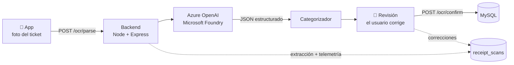

<div align="center">

# 📱 ExpendiNator

**Sacale una foto al ticket y la IA carga tus gastos por vos.**

App Android de gastos personales que lee tickets de compra con un modelo multimodal en **Azure**, los categoriza y te deja controlar presupuestos.


</div>

<p align="center">
  
  
  
</p>

<details>
<summary>Más capturas</summary>
<p align="center">
  
  
  
</p>
</details>

---

## ✨ Qué hace

| | |
|---|---|
| 📸 **Escaneo de tickets con IA** | Sacás una foto y un modelo multimodal extrae comercio, fecha, ítems, cantidades y montos. Vos revisás y confirmás. |
| 🏷️ **Categorías propias** | Con nombre, color y palabras clave. La IA sugiere la categoría de cada ítem. |
| 📊 **Presupuestos** | Mensuales, semanales o anuales por categoría, con barra de progreso. |
| 📈 **Reportes** | Gastos agrupados por categoría, totales del período e historial. |
| 🧩 **Widget** | Acceso directo al escaneo y total del día o del mes. |

---

## 🧠 Cómo funciona el escaneo



- **Structured Outputs:** el modelo está obligado a responder con un JSON Schema estricto, así el backend nunca recibe una respuesta mal formada.
- **Prompt versionado** (`backend/prompts/`): cada escaneo registra qué versión del prompt y qué modelo se usaron, con su latencia y sus tokens.
- **Feedback humano:** lo que el usuario corrige al confirmar se guarda junto a lo que extrajo el modelo. Sirve para medir errores reales y como dataset para entrenar un clasificador.
- **Prompt adaptado a tickets argentinos:** formato `1.250,50`, líneas `2 x ...`, descuentos en negativo, fechas día/mes/año.
- **Controles de calidad:** si la suma de los ítems no coincide con el total del ticket, la app lo avisa para que se revise.

---

## 📏 Evaluación

El extractor se mide contra un dataset de tickets reales etiquetados a mano (`npm run eval`), para comparar versiones de prompt y de modelo con números.

| Métrica | Qué mide | Resultado |
|---|---|---|
| Total correcto | Total leído vs. real (±$1) | _pendiente_ |
| Fecha correcta | Coincidencia exacta | _pendiente_ |
| Ítems: precisión / recall | Ítems reales encontrados vs. inventados | _pendiente_ |
| Categoría | Categoría sugerida correcta | _pendiente_ |
| Latencia p50 / p95 | Experiencia de usuario | _pendiente_ |

Más detalle en [`backend/eval/README.md`](backend/eval/README.md).

---

## 🗺️ Roadmap

- [x] Escaneo real con Azure OpenAI y Structured Outputs
- [x] Registro de escaneos y correcciones del usuario
- [x] Evaluación offline del extractor
- [ ] Clasificador de categorías entrenado en **Azure Machine Learning** con las correcciones de los usuarios (MLflow, model registry, managed online endpoint)
- [ ] CI/CD con GitHub Actions y monitoreo (Application Insights, drift)
- [ ] Consultas en lenguaje natural sobre tus gastos ("¿cuánto gasté en súper este mes?")

---

## 🚀 Correrlo localmente

### Requisitos
Node.js, MySQL, Android Studio y, para el escaneo con IA, un recurso de Azure OpenAI / Microsoft Foundry.

### 1. Base de datos
Ejecutá `backend/sql/db-script.sql` en MySQL. Crea la base `expendinatordb` con todas las tablas.

> Si ya tenías la base de antes, ejecutá además `backend/sql/002-receipt-scans.sql`.

### 2. Variables de entorno
Dentro de `backend/`, copiá `.env.example` a `.env` y completá:

```env
DB_HOST=localhost
DB_USER=root
DB_PASS=
JWT_SECRET=un-secreto-largo

AZURE_OPENAI_ENDPOINT=https://<tu-recurso>.openai.azure.com/
AZURE_OPENAI_API_KEY=...
AZURE_OPENAI_DEPLOYMENT=gpt-4.1-mini
```

Para el modelo: en Microsoft Foundry creá un proyecto, desplegá un modelo con visión (por ejemplo `gpt-4.1-mini`) y copiá el endpoint y la clave.

> Sin las variables de Azure la app igual funciona: `/ocr/mock` devuelve un ticket de ejemplo para probar.

### 3. Backend
```bash
cd backend
npm install
npm run dev        # http://localhost:3000
```

### 4. App
Abrí el proyecto en Android Studio y corré la app en un emulador. Apunta a `http://10.0.2.2:3000`, que es el backend local visto desde el emulador.

---

## 🧩 Estructura

```
app/                          App Android (Kotlin + Jetpack Compose + Ktor)
backend/
├── prompts/                  Prompts versionados
├── src/ai/                   Cliente de Azure, extractor y categorizador
├── src/controllers/          Endpoints (OCR, gastos, categorías, presupuestos, auth)
├── sql/                      Esquema y migraciones
└── eval/                     Evaluación del extractor
```

---

## 👥 Créditos

ExpendiNator nació como proyecto grupal de la materia de desarrollo mobile de **UTN FRBA** ([repo original](https://github.com/UTN-FRBA-Mobile/ExpendiNator)).

En este fork sumé la capa de IA: el escaneo real con Azure OpenAI, el registro de correcciones, la evaluación y el roadmap de MLOps.
